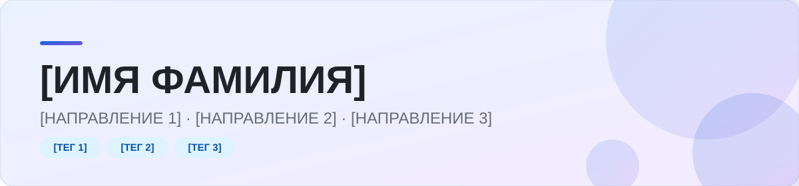
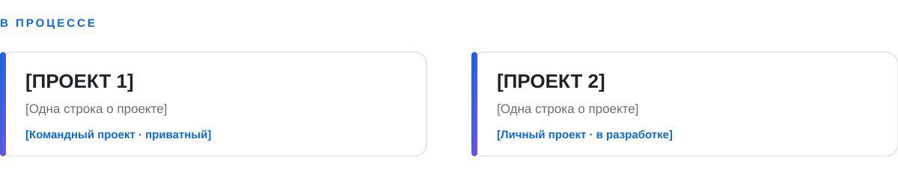
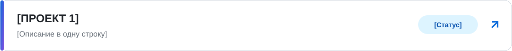
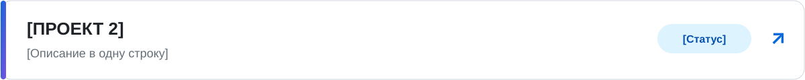
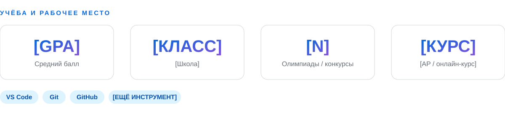

<picture><source media="(prefers-color-scheme: dark)" srcset="assets/header-dark.svg"><source media="(prefers-color-scheme: light)" srcset="assets/header-light.svg"></picture>

[Атбасар НИШ / 7А] ученик. Работаю над [resush], учусь через проекты и [хакатоны].

## В процессе

<picture><source media="(prefers-color-scheme: dark)" srcset="assets/building-dark.svg"><source media="(prefers-color-scheme: light)" srcset="assets/building-light.svg"></picture>

<picture><source media="(prefers-color-scheme: dark)" srcset="assets/project-index-dark.svg"><source media="(prefers-color-scheme: light)" srcset="assets/project-index-light.svg"></picture>

<a href="[ССЫЛКА НА РЕПОЗИТОРИЙ 1]"><picture><source media="(prefers-color-scheme: dark)" srcset="assets/index-p1-dark.svg"><source media="(prefers-color-scheme: light)" srcset="assets/index-p1-light.svg"></picture></a>

<a href="[ССЫЛКА НА РЕПОЗИТОРИЙ 2]"><picture><source media="(prefers-color-scheme: dark)" srcset="assets/index-p2-dark.svg"><source media="(prefers-color-scheme: light)" srcset="assets/index-p2-light.svg"></picture></a>

<a href="[ССЫЛКА НА РЕПОЗИТОРИЙ 3]"><picture><source media="(prefers-color-scheme: dark)" srcset="assets/index-p3-dark.svg"><source media="(prefers-color-scheme: light)" srcset="assets/index-p3-light.svg"></picture></a>

## Учёба и рабочее место

<picture><source media="(prefers-color-scheme: dark)" srcset="assets/study-dark.svg"><source media="(prefers-color-scheme: light)" srcset="assets/study-light.svg"></picture>

## Технологии

01 <strong>Веб-разработка</strong> [HTML · CSS · JavaScript · TypeScript] [React · Next.js]

02 <strong>Данные и прототипы</strong> [Python · Supabase · PostgreSQL]

03 <strong>Решение задач</strong> [Алгоритмы · структуры данных · математика]

Технологии, которые использую и продолжаю изучать.

## Связаться со мной

<strong>Открыт к идеям и сотрудничеству.</strong> Есть проект, хакатон или идея, которую стоит реализовать? Напишите мне.

<a href="https://t.me/[TELEGRAM_USERNAME]"><picture><source media="(prefers-color-scheme: dark)" srcset="assets/contact-telegram-dark.svg"><source media="(prefers-color-scheme: light)" srcset="assets/contact-telegram-light.svg"></picture></a>
<a href="https://www.instagram.com/[INSTAGRAM_USERNAME]/"><picture><source media="(prefers-color-scheme: dark)" srcset="assets/contact-instagram-dark.svg"><source media="(prefers-color-scheme: light)" srcset="assets/contact-instagram-light.svg"></picture></a>

[Все репозитории ↗](https://github.com/cf-sea?tab=repositories)
